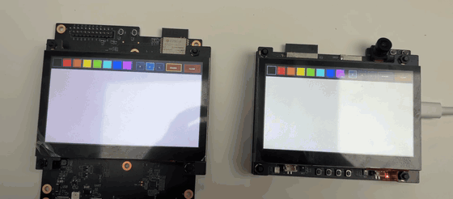

# esp-touch-paint

A finger-paint program for Espressif boards with an 800x480 RGB LCD and a Goodix touch
controller, written in bare-metal Rust with [esp-hal](https://github.com/esp-rs/esp-hal).

Boards that run it share the canvas over ESP-NOW: draw on one board, and the strokes appear on all
of them.



## Boards

| Board | Feature | Restore button |
| --- | --- | --- |
| [ESP32-S3-LCD-EV-Board](https://docs.espressif.com/projects/esp-dev-kits/en/latest/esp32s3/esp32-s3-lcd-ev-board/) with the 4.3" SUB3 subboard (800x480, ST7262 + GT1151) | `esp32s3` | BOOT |
| ESP32-S31-Korvo-1 with its LCD subboard | `esp32s31` | SET |

The ESP32-S3-LCD-EV-Board pins are for board versions before v1.5, which have the
ESP32-S3-WROOM-1-N16R8 module.

## Build and flash

You need [espflash](https://github.com/esp-rs/espflash). The pinned nightly toolchain in
`rust-toolchain.toml` builds for the ESP32-S31. The ESP32-S3 is an Xtensa chip and needs
Espressif's toolchain from [espup](https://github.com/esp-rs/espup).

```sh
# ESP32-S31-Korvo-1
cargo run-korvo

# ESP32-S3-LCD-EV-Board
espup install
source ~/export-esp.sh
cargo +esp run-s3
```

`cargo build-korvo` and `cargo +esp build-s3` build without flashing. If more than one board is
connected, add `-- --port <PORT>`.

## Use

- Draw on the white canvas with one finger.
- The toolbar at the top has 8 colors, 3 brush sizes (S, M and L), an eraser and CLEAR.
- The restore button draws the demo picture again.

Flash two or more boards and draw on any of them. Strokes, CLEAR and the restored picture appear
on all boards on ESP-NOW channel 1. Each board keeps its own color and brush. A board that starts
later sees only new drawing, not the strokes from before it started.

## How it works

- The ESP32-S3's LCD reads the PSRAM framebuffer through a ring of bounce buffers in internal
  RAM. A memory-to-memory DMA refills them, like
  [esp-bsp](https://github.com/espressif/esp-bsp) does for this board. Without them, the CPU's
  PSRAM accesses make the LCD miss pixels, and the picture shifts.
- The ESP32-S31's LCD reads the PSRAM framebuffer directly through a circular DMA descriptor
  chain at 14 MHz, with high DMA priority.
- Each board broadcasts its drawing operations with sequence numbers. Each packet repeats the
  last few operations, because ESP-NOW broadcasts have no acknowledgements.

The display settings come from
[mnemosyne-dashboard](https://github.com/bugadani/mnemosyne-dashboard), which uses the same two
boards.

## esp-hal version

The ESP32-S31 LCD driver is not in an esp-hal release yet. `Cargo.toml` uses the crates.io
versions and patches them to an esp-hal Git revision. Remove the `[patch.crates-io]` section when
a release has the driver.
